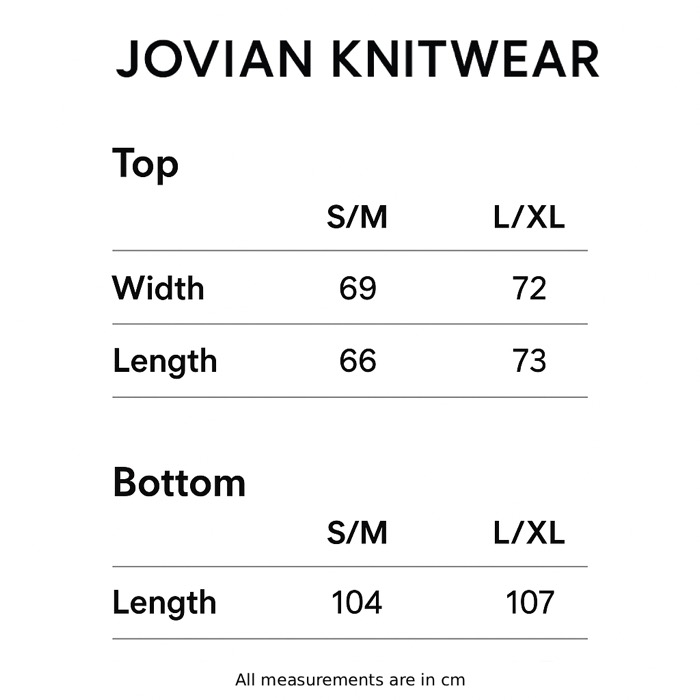

# Jovian Wear — Knitwear Brand E-Commerce

**Jovian** is an Egyptian knitwear clothing brand (`@jovian_eg`). I built and ran its online store on **Shopify**,
then rebuilt the store as a **standalone full-stack application** (this repository) so it no longer depends on the Shopify platform.

| | | |
| --- | --- | --- |
|  |  |  |

## 1. Shopify store

- Set up the store from scratch: theme customization, navigation, homepage and brand styling
- Product catalog with variants (sizes S/M, L/XL), collections and size charts
- Checkout, shipping and payment configuration for the Egyptian market
- Campaign and sale creatives for product launches



## 2. Standalone rebuild (this repo)

The Shopify theme converted into a full-stack app with its own backend and database.

**Features:** product catalog with variants, collections, search and filtering, cart, user registration and login (JWT),
accounts and addresses, order management, blog and articles, inventory, and Stripe-ready payments.

| Layer | Tech |
| --- | --- |
| Backend | Node.js · Express · MongoDB (Mongoose) · JWT · bcrypt · Stripe |
| Frontend | HTML · CSS · vanilla JavaScript (shop, product, cart pages calling the REST API) |

```
backend/
  server.js
  src/models/    Product, Collection, Cart, Order, User, Blog, Article
  src/routes/    products, collections, cart, orders, users, blog, payments
frontend/public/ index, shop, product, cart pages + assets
seed.js          sample catalog
docs/setup/      API reference, setup guide, file structure
```

### Run locally

Requires Node.js 18+ and MongoDB.

```bash
npm install
cp .env.example .env      # set MONGODB_URI, JWT_SECRET and Stripe test keys
node seed.js              # load sample products
npm run backend           # API on http://localhost:5000
npm run frontend          # site on http://localhost:3000
```

See [`docs/setup/API_REFERENCE.md`](docs/setup/API_REFERENCE.md) for the endpoints.
